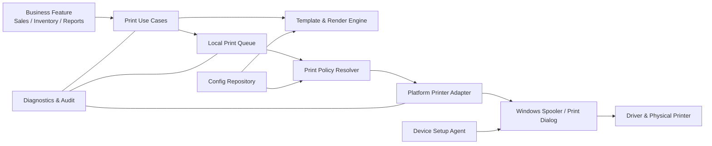
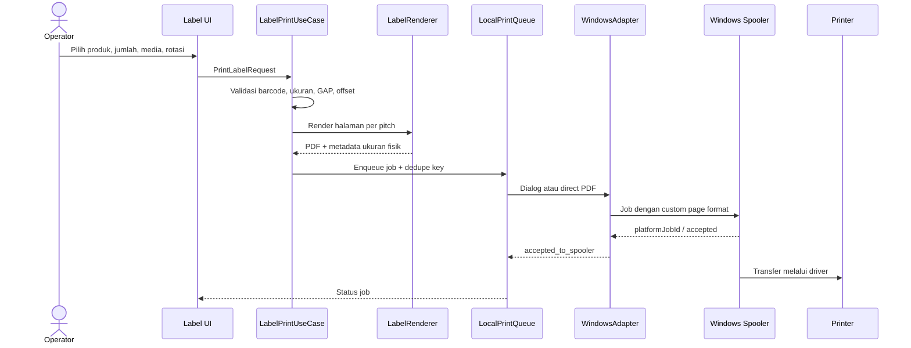
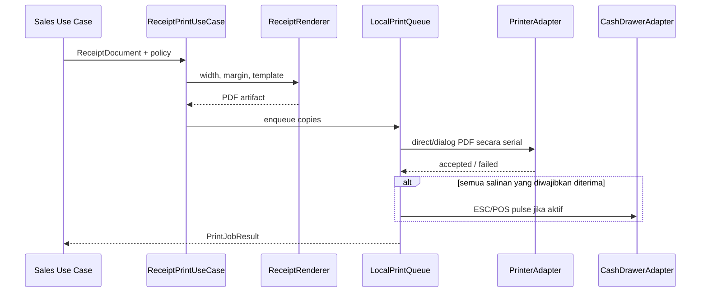
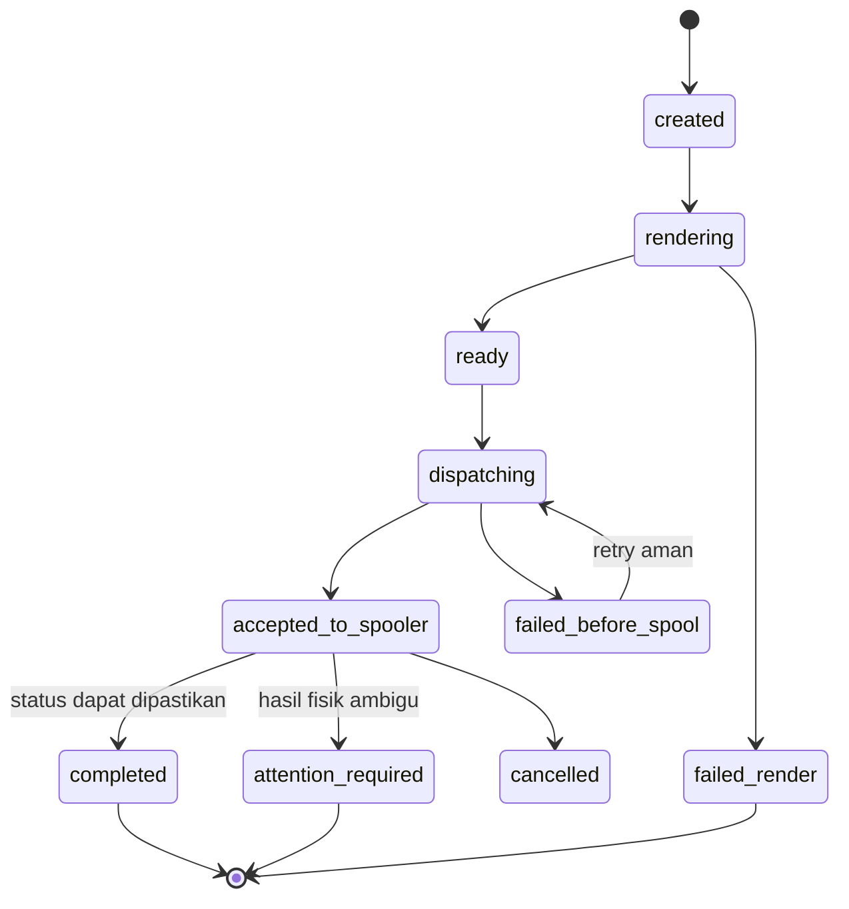

# Arsitektur Printing Universal untuk Aplikasi All-Role

Status: rancangan implementasi 1.0  
Referensi implementasi: Kasir Toko Plastik Berkah v1.0.23  
Target awal: Flutter Desktop Windows, dapat diperluas ke Android dan platform lain

## 1. Tujuan

Modul printing harus dapat dipakai oleh semua role dan jenis usaha tanpa
mengikat aplikasi pada satu merek printer. Modul harus mendukung:

- nota thermal 58 mm dan 80 mm;
- label barcode dengan ukuran, GAP, jumlah kolom, rotasi, dan offset berbeda;
- direct print maupun dialog printer sistem operasi;
- konfigurasi printer berbeda pada setiap PC/lokasi;
- printer khusus seperti Blueprint ECO80BT tanpa menyebarkan aturan vendornya
  ke business logic;
- antrean lokal yang aman, diagnosis, dan pemulihan tanpa menggandakan cetakan;
- laci uang melalui perintah ESC/POS;
- pembatasan akses berdasarkan role.

## 2. Pelajaran dari aplikasi saat ini

### 2.1 Label

Alur yang sudah stabil:

1. Produk dan satuan dipetakan menjadi `ProductLabelData`.
2. Operator memilih ukuran stiker, GAP, jumlah, kolom, rotasi, dan offset.
3. Aplikasi membuat PDF dengan ukuran fisik dalam milimeter.
4. Satu halaman PDF mewakili satu langkah media:
   `pageHeight = labelHeight + gap`.
5. Konten ditempatkan dari kiri atas, margin halaman nol, lalu diberi safe
   margin 1,5 mm di dalam stiker.
6. PDF dikirim melalui dialog Windows dan driver printer.

Rumus pitch pada langkah 4 wajib dipertahankan. Jika halaman hanya memakai
tinggi stiker, posisi akan bergeser sebesar GAP pada setiap label berikutnya.
Contoh stiker 40 × 20 mm dengan GAP 2 mm harus memakai halaman 40 × 22 mm.

Blueprint ECO80BT mempunyai perilaku khusus:

- driver/queue: `80Label` / `80Label Printer`;
- perangkat USB: VID `09C5`, PID `807A`;
- roll 40 mm berada di sisi kiri jalur 80 mm;
- alignment dan horizontal offset driver harus `0` agar origin berada di kiri;
- port `USB00x` tidak boleh di-hardcode karena dapat berubah pada PC lain;
- port dicari melalui device path atau VID/PID;
- PDF lewat driver Windows terbukti lebih cocok daripada mengirim TSPL mentah
  ke queue driver vendor ini.

### 2.2 Nota

Alur nota saat ini:

- nota dirender menjadi PDF dengan lebar 58 atau 80 mm;
- tinggi dihitung dari jumlah item agar feed kosong tidak berlebihan;
- margin minimum aman: 2,5 mm untuk 58 mm dan 3 mm untuk 80 mm;
- jika printer yang tersimpan ditemukan, sistem dapat direct print;
- jika printer tidak ditemukan, dialog Windows menjadi fallback;
- laci uang menggunakan RAW ESC/POS setelah nota berhasil dikirim.

Catatan migrasi: nilai `receiptCopies` sudah tersimpan pada aplikasi referensi,
tetapi alur transaksi sekarang masih memanggil preview satu kali. Implementasi
all-role harus menjalankan kebijakan salinan di `PrintQueue`, bukan di UI.

## 3. Batas domain

Printing dipisah menjadi enam lapisan. Business feature tidak boleh memanggil
plugin Windows, FFI, PowerShell, atau library PDF secara langsung.



### 3.1 Business Feature

Hanya mengirim data semantik, misalnya `ReceiptDocument` atau
`ProductLabelDocument`. Feature tidak mengetahui nama printer dan port USB.

### 3.2 Print Use Cases

API publik modul:

- `printReceipt(request)`
- `previewReceipt(request)`
- `printProductLabels(request)`
- `previewProductLabels(request)`
- `printReport(request)`
- `openCashDrawer(bindingId)`
- `testPrinter(bindingId)`
- `getJobStatus(jobId)`
- `retryBeforeSpool(jobId)`
- `cancelJob(jobId)`

### 3.3 Template & Render Engine

Mengubah dokumen semantik menjadi artifact cetak:

- `PdfArtifact` untuk nota, label via driver, dan laporan;
- `RawArtifact` hanya untuk device profile yang benar-benar mendukung bahasa
  printer seperti ESC/POS, TSPL, ZPL, atau CPCL;
- `PreviewArtifact` untuk preview UI.

### 3.4 Local Print Queue

Menyimpan dan mengirim job secara serial per printer. Queue ini berbeda dari
Windows Spooler: queue aplikasi memberikan status bisnis, retry policy, audit,
dan perlindungan dari klik ganda.

### 3.5 Print Policy Resolver

Menentukan gabungan konfigurasi berdasarkan urutan:

1. override pada request;
2. binding workstation;
3. konfigurasi lokasi/cabang;
4. default organisasi;
5. default device profile.

### 3.6 Platform Printer Adapter

Kontrak platform, tanpa logika bisnis:

```dart
abstract interface class PlatformPrinterAdapter {
  Future<List<DiscoveredPrinter>> discover();
  Future<DispatchResult> directPrintPdf(PdfDispatch command);
  Future<DispatchResult> showPrintDialog(PdfDispatch command);
  Future<DispatchResult> sendRaw(RawDispatch command);
  Future<PrinterHealth> inspect(PrinterBinding binding);
  Future<List<PlatformPrintJob>> listJobs(PrinterBinding binding);
  Future<void> cancelJob(PrinterBinding binding, String platformJobId);
}
```

## 4. Model konfigurasi

Konfigurasi harus dipisah menjadi empat objek.

### 4.1 `PrinterProfile`

Profil kemampuan model printer. Dapat dibundel oleh aplikasi atau diperbarui
oleh admin. Contoh lengkap ada di `profiles/blueprint_eco80bt.json` dan
`profiles/generic_thermal_receipt.json`.

Field penting:

- `kind`: `label`, `receipt`, `document`, atau `hybrid`;
- selector driver/perangkat;
- transport: `windows_driver`, `raw_spooler`, `network_raw`, atau `bluetooth`;
- media dan DPI;
- bahasa RAW yang didukung;
- dispatch mode default;
- capability laci uang;
- aturan setup/repair khusus vendor.

### 4.2 `PrinterBinding`

Binding printer fisik pada satu workstation. Ini data lokal, tidak boleh
ditimpa sinkronisasi antar-PC.

```text
id
organization_id
location_id
workstation_id
purpose                 receipt | label | report
profile_id
platform_printer_name
driver_name
port_name
device_instance_id
usb_vid
usb_pid
connection_fingerprint
is_default
is_enabled
last_seen_at
last_health
```

Nama queue saja tidak cukup sebagai identitas. `connection_fingerprint`
sebaiknya dibuat dari driver + device instance/VID/PID + port/host.

### 4.3 `MediaPreset`

```text
id
scope                    global | organization | location | workstation
kind                     receipt | label
name
width_mm
height_mm                nullable untuk nota continuous
gap_mm
columns
orientation
safe_margin_mm
offset_x_mm
offset_y_mm
sensor_mode              gap | black_mark | continuous
```

### 4.4 `PrintPolicy`

```text
purpose
dispatch_mode            direct | system_dialog | ask_each_time
copies
fallback_to_dialog
open_cash_drawer
cash_drawer_pin
retry_before_spool
job_timeout_seconds
retain_artifact_hours
```

## 5. Pemisahan konfigurasi cloud dan lokal

Untuk aplikasi universal/multi-tenant:

| Konfigurasi | Lokasi simpan | Disinkronkan |
|---|---|---|
| Template nota/label | database organisasi | Ya |
| Default ukuran media | organisasi/lokasi | Ya |
| Hak akses print | organisasi | Ya |
| Nama queue Windows | workstation lokal | Tidak |
| Port USB / device path | workstation lokal | Tidak |
| Offset hasil kalibrasi | workstation + printer + media | Opsional |
| Job queue belum selesai | workstation lokal | Tidak |
| Audit hasil print | lokal lalu sinkron async | Ya |

Dengan model ini, instalasi pada PC baru tidak membawa nama `USB001` atau nama
printer milik laptop pengembang.

## 6. Pipeline label



### 6.1 Rumus media

```text
contentWidthMm = labelWidthMm × columns
pageWidthMm    = contentWidthMm
pageHeightMm   = labelHeightMm + gapMm
pageCount      = ceil(copies / columns)
```

Setiap halaman berisi maksimal `columns` stiker. Halaman terakhir boleh berisi
sel kosong. Konten harus di-clip ke batas tiap stiker.

### 6.2 Koordinat

- origin aplikasi selalu kiri atas;
- `offsetX > 0` menggeser isi ke kanan;
- `offsetY > 0` menggeser isi ke bawah;
- offset diterapkan pada konten, bukan mengubah pitch;
- safe margin diterapkan setelah offset;
- ukuran disimpan sebagai desimal milimeter, dikonversi ke point hanya di
  renderer.

### 6.3 Sensor GAP

Pitch aplikasi mencegah drift pada dokumen, tetapi tidak menggantikan kalibrasi
sensor fisik. Setup wizard harus meminta operator:

1. memasang roll lurus pada guide;
2. memilih `sensor_mode = gap`;
3. menjalankan feed/calibration bawaan printer;
4. mencetak pola kalibrasi 5–10 label;
5. menyimpan offset hanya setelah hasil konsisten.

Jika profil dan transport mendukung TSPL/ZPL secara native, calibration command
dapat ditambahkan ke adapter RAW. Untuk ECO80BT dengan queue driver yang sudah
terbukti, gunakan driver PDF dan jangan mengasumsikan TSPL mentah kompatibel.

### 6.4 Preset awal ECO80BT

```text
label                 40 × 20 mm
gap                   2 mm
page/pitch            40 × 22 mm
columns               1
safe margin           1.5 mm
origin                top-left
driver alignment      left (0)
driver offset         0
dispatch              system dialog
use printer settings  false
```

## 7. Pipeline nota



### 7.1 Ukuran nota

Default yang aman:

| Media | Lebar | Margin minimum | Font isi |
|---|---:|---:|---:|
| Thermal kecil | 58 mm | 2,5 mm | 7–8 pt |
| Thermal besar | 80 mm | 3 mm | 8–9,5 pt |

Tinggi dapat dihitung secara konservatif atau memakai halaman continuous jika
adapter mendukung. Formula referensi saat ini adalah:

```text
heightMm = 90 + itemCount × 22
```

Untuk template universal, renderer sebaiknya mengukur layout aktual dan
menambah tail feed 3–8 mm, bukan hanya mengandalkan jumlah item.

### 7.2 Jumlah salinan

`copies` dijalankan di queue. Jangan membuat beberapa request dari tombol UI.

- jika driver mendukung copies dengan konsisten, satu platform job boleh dipakai;
- jika tidak, kirim satu per satu dan tunggu status `accepted_to_spooler`;
- job salinan mempunyai `parent_job_id` yang sama;
- laci uang hanya dibuka sekali setelah salinan wajib diterima.

### 7.3 Fallback

Jika binding direct print tidak ditemukan:

1. tandai health `binding_missing`;
2. jika policy mengizinkan, tampilkan dialog sistem;
3. jangan diam-diam memilih default printer Windows;
4. tawarkan admin memperbaiki binding setelah transaksi selesai.

## 8. State machine antrean



Aturan terpenting: setelah OS menerima job, aplikasi tidak boleh melakukan
auto-retry hanya karena printer belum bergerak. Status tersebut ambigu dan
retry dapat menghasilkan label/nota ganda. Operator harus memilih `Cetak ulang`
secara eksplisit.

Queue harus:

- serial per `bindingId`;
- tetap dapat paralel untuk dua printer berbeda;
- memakai mutex lintas isolate/process;
- mempunyai `dedupeKey` untuk mencegah double-click;
- menyimpan artifact dan metadata sebelum dispatch;
- membedakan error render, binding, spooler, driver, dan perangkat.

## 9. Kontrak job dan hasil

```dart
enum PrintPurpose { receipt, productLabel, report, cashDrawer }
enum DispatchMode { direct, systemDialog, askEachTime }
enum PrintJobState {
  created,
  rendering,
  ready,
  dispatching,
  acceptedToSpooler,
  completed,
  failedRender,
  failedBeforeSpool,
  attentionRequired,
  cancelled,
}

final class PrintJobResult {
  const PrintJobResult({
    required this.jobId,
    required this.state,
    required this.userMessage,
    this.platformJobId,
    this.errorCode,
    this.retrySafe = false,
  });

  final String jobId;
  final PrintJobState state;
  final String userMessage;
  final String? platformJobId;
  final String? errorCode;
  final bool retrySafe;
}
```

Jangan gunakan `bool` sebagai satu-satunya hasil printing. `true` dari API OS
biasanya berarti job diterima, bukan kertas pasti sudah keluar.

## 10. Device Setup Agent Windows

Setup/repair printer dipisah dari aplikasi kasir harian karena membutuhkan hak
administrator. Agent dijalankan saat installer atau melalui tombol admin
`Perbaiki printer` dengan elevation.

Tanggung jawab agent:

- mendeteksi driver;
- menemukan port dari device path atau VID/PID;
- membuat/memperbaiki queue;
- menghapus hanya queue rusak yang diketahui;
- membersihkan job tertahan hanya pada queue target dan dengan konfirmasi;
- menerapkan registry/config vendor dari profile;
- restart spooler jika benar-benar diperlukan;
- mengaktifkan log PrintService;
- menulis hasil machine-readable dan log teks.

Kontrak hasil agent:

```json
{
  "success": true,
  "profileId": "blueprint-eco80bt-windows",
  "queueName": "80Label Printer",
  "driverName": "80Label",
  "portName": "USB001",
  "deviceFingerprint": "usb:09c5:807a:...",
  "actions": ["queue_rebound", "alignment_left", "spooler_restarted"],
  "warnings": []
}
```

`USB001` hanya output hasil deteksi pada PC tersebut, bukan nilai yang dibundel
dalam konfigurasi aplikasi.

## 11. Diagnosis dan observability

Setiap job wajib mempunyai `correlationId`. Log minimal:

```text
timestamp
job_id / correlation_id
organization_id / location_id / workstation_id
user_id / role_id
purpose
template_id / media_preset_id / binding_id / profile_id
artifact bytes dan page size
dispatch mode
printer, driver, port, fingerprint
platform_job_id
state transition
error_code dan ringkasan error
```

Jangan menyimpan isi lengkap nota, nama pelanggan, atau data sensitif dalam log
default. Simpan hash dokumen untuk korelasi. Artifact memiliki masa retensi
terbatas dan harus dapat dimatikan untuk organisasi sensitif.

Kode error yang disarankan:

- `PRINTER_NOT_BOUND`
- `PRINTER_NOT_FOUND`
- `DRIVER_NOT_FOUND`
- `DEVICE_OFFLINE`
- `QUEUE_PAUSED`
- `SPOOLER_UNAVAILABLE`
- `RENDER_INVALID_MEDIA`
- `RAW_LANGUAGE_UNSUPPORTED`
- `DISPATCH_REJECTED`
- `DISPATCH_AMBIGUOUS`

## 12. Hak akses all-role

| Capability | Contoh role |
|---|---|
| `print.receipt` | kasir, supervisor |
| `reprint.receipt` | supervisor, admin |
| `print.label` | gudang, inventory, admin |
| `print.label.override_price` | inventory manager, admin |
| `print.report` | owner, finance, admin |
| `printer.configure` | admin perangkat |
| `printer.repair` | admin perangkat |
| `printer.view_diagnostics` | support, admin |

Reprint harus meminta alasan dan ditulis ke audit. Role non-admin tidak boleh
mengubah binding, port, driver, atau registry.

## 13. Struktur package yang disarankan

```text
lib/core/printing/
  domain/
    print_document.dart
    print_job.dart
    print_result.dart
    printer_profile.dart
    printer_binding.dart
    media_preset.dart
    print_policy.dart
  application/
    print_receipt_use_case.dart
    print_label_use_case.dart
    preview_use_case.dart
    repair_printer_use_case.dart
    print_queue.dart
    print_policy_resolver.dart
  rendering/
    receipt_renderer.dart
    label_renderer.dart
    report_renderer.dart
  infrastructure/
    platform_printer_adapter.dart
    windows_printing_adapter.dart
    windows_raw_spooler_adapter.dart
    local_print_job_repository.dart
    print_diagnostics_repository.dart
  presentation/
    printer_settings_page.dart
    label_print_dialog.dart
    print_job_status.dart
tools/windows/
  printer_setup_agent.ps1
assets/printer_profiles/
  *.json
```

## 14. Skema database minimum

```sql
CREATE TABLE printer_bindings (
  id TEXT PRIMARY KEY,
  organization_id TEXT NOT NULL,
  location_id TEXT NOT NULL,
  workstation_id TEXT NOT NULL,
  purpose TEXT NOT NULL,
  profile_id TEXT NOT NULL,
  platform_printer_name TEXT NOT NULL,
  driver_name TEXT,
  port_name TEXT,
  device_fingerprint TEXT,
  is_default INTEGER NOT NULL DEFAULT 0,
  is_enabled INTEGER NOT NULL DEFAULT 1,
  last_seen_at TEXT,
  last_health TEXT,
  updated_at TEXT NOT NULL
);

CREATE TABLE media_presets (
  id TEXT PRIMARY KEY,
  scope_type TEXT NOT NULL,
  scope_id TEXT NOT NULL,
  kind TEXT NOT NULL,
  name TEXT NOT NULL,
  width_mm REAL NOT NULL,
  height_mm REAL,
  gap_mm REAL NOT NULL DEFAULT 0,
  columns_count INTEGER NOT NULL DEFAULT 1,
  orientation TEXT NOT NULL DEFAULT 'normal',
  safe_margin_mm REAL NOT NULL DEFAULT 0,
  offset_x_mm REAL NOT NULL DEFAULT 0,
  offset_y_mm REAL NOT NULL DEFAULT 0,
  sensor_mode TEXT,
  updated_at TEXT NOT NULL
);

CREATE TABLE print_jobs (
  id TEXT PRIMARY KEY,
  parent_job_id TEXT,
  dedupe_key TEXT,
  purpose TEXT NOT NULL,
  binding_id TEXT,
  media_preset_id TEXT,
  requested_by TEXT NOT NULL,
  state TEXT NOT NULL,
  dispatch_mode TEXT NOT NULL,
  copies INTEGER NOT NULL DEFAULT 1,
  artifact_path TEXT,
  artifact_sha256 TEXT,
  platform_job_id TEXT,
  error_code TEXT,
  error_message TEXT,
  retry_safe INTEGER NOT NULL DEFAULT 0,
  created_at TEXT NOT NULL,
  updated_at TEXT NOT NULL
);
```

Tambahkan unique index aktif pada `dedupe_key` sesuai teknologi database yang
dipakai agar double-click tidak membuat dua job.

## 15. Strategi implementasi bertahap

### Fase 1 — Ekstraksi domain

- pindahkan model label/nota keluar dari `PrintService` statis;
- buat interface renderer, adapter, repository, dan use case;
- pertahankan output PDF yang sekarang agar risiko kecil.

### Fase 2 — Binding lokal

- pisahkan `StoreSettings` dari konfigurasi workstation;
- simpan binding per purpose;
- tambahkan discovery, test print, health, dan fallback dialog.

### Fase 3 — Queue dan hasil terstruktur

- buat local outbox/queue;
- ubah hasil `bool` menjadi `PrintJobResult`;
- implementasikan copies, dedupe, status, dan manual reprint.

### Fase 4 — Device profiles

- pindahkan aturan ECO80BT ke JSON profile + setup agent;
- tambahkan generic receipt profile;
- baru setelah stabil tambahkan TSPL/ZPL/ESC-POS renderer lain.

### Fase 5 — All-role dan sinkronisasi

- capability-based authorization;
- audit reprint;
- sinkronisasi konfigurasi organisasi tanpa menimpa binding lokal;
- dashboard health printer per workstation.

## 16. Acceptance test wajib

### Label

- 40 × 20 mm, GAP 2 mm, minimal 20 label berurutan tanpa drift;
- posisi kiri pada media 80 mm;
- portrait dan rotasi 90/180/270 derajat;
- offset negatif/positif;
- 1–3 kolom dan halaman terakhir parsial;
- barcode Code 128 dapat dipindai;
- printer offline tidak memicu auto-retry setelah job diterima spooler;
- PC baru memilih port berdasarkan fingerprint, bukan nomor USB tetap.

### Nota

- nota 58 dan 80 mm tidak terpotong;
- nama produk panjang dan kuantitas desimal;
- 1, 2, dan 3 salinan benar;
- printer tersimpan hilang → fallback sesuai policy;
- laci terbuka sekali setelah print diterima;
- reprint membutuhkan capability dan audit.

### Infrastruktur

- queue serial pada printer yang sama dan paralel pada printer berbeda;
- restart aplikasi melanjutkan job yang aman;
- status ambigu tidak dicetak ulang otomatis;
- repair agent tidak menghapus queue/printer di luar target;
- log tidak membocorkan data transaksi sensitif.

## 17. Keputusan yang tidak boleh diubah tanpa pengujian fisik

1. Label pitch selalu `height + gap`.
2. Offset tidak boleh mengubah pitch.
3. Port USB tidak boleh di-hardcode.
4. Binding printer adalah konfigurasi workstation lokal.
5. Setelah diterima spooler, retry otomatis dilarang.
6. RAW hanya digunakan jika device profile menyatakan bahasa printer cocok.
7. ECO80BT menggunakan origin kiri dan jalur driver Windows yang sudah terbukti.
8. Konfigurasi/repair driver dilakukan dengan elevation, printing harian tidak.

## 18. Pemetaan kode referensi

| Area | Implementasi saat ini |
|---|---|
| Render dan dispatch nota/label | `lib/core/printing/print_service.dart` |
| Opsi label dan rumus pitch | `lib/core/printing/label_print_options.dart` |
| UI konfigurasi label | `lib/core/printing/label_print_dialog.dart` |
| RAW Windows spooler | `lib/core/printing/raw_printer_service.dart` |
| Laci uang ESC/POS | `lib/core/printing/cash_drawer_service.dart` |
| Log printing | `lib/core/printing/print_diagnostics.dart` |
| Pengaturan printer/media | `lib/features/settings/` |
| Repair ECO80BT | `installer/configure_eco80bt.ps1` |
| Integrasi installer | `installer/kasir_plx.iss` |

